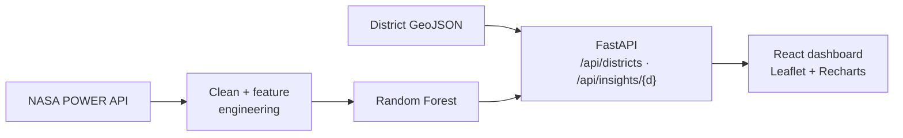

<h1 align="center">🌾 AgroNepal Intelligence</h1>

<p align="center">Climate data + machine learning → crop recommendations for all 77 districts of Nepal, on an interactive map.</p>

<p align="center">
  
  
  
  
</p>

<p align="center"></p>

> **Partial upload.** The screenshots show the working app, but this repo only has the API entry point
> and the HTML shell. The ML pipeline, React source and datasets aren't committed yet.
> [Details →](#status--known-issues)

## Features

| | |
|---|---|
| 🗺️ **District map** | All 77 districts (Leaflet), hover insights |
| 🌦️ **Climate profile** | Temperature, rainfall and humidity history from the **NASA POWER** API |
| 🌱 **Crop recommendation** | Random Forest on climate and ecology features → top crops, companion planting, climate risks |
| 📈 **Trends** | 10-year rainfall and temperature charts (Recharts) |
| 💧 **Resources** | Irrigation coverage and farmland indicators |

<table>
  <tr>
    <td width="33%"><br><sub>District intelligence</sub></td>
    <td width="33%"><br><sub>Climate trends</sub></td>
    <td width="33%"><br><sub>Crop recommendation</sub></td>
  </tr>
</table>

## How it works



## In this repo

| File | What it does |
|---|---|
| `main.py` | FastAPI app: `/api/health`, `/api/districts` (GeoJSON), `/api/insights/{district}` |
| `seed_districts.py` | Downloads Nepal's district GeoJSON into `data/` |
| `index.html` | Vite entry page for the React app |

```bash
pip install fastapi uvicorn
python seed_districts.py           # fetches data/nepal_districts.geojson
python main.py                     # needs ml_pipeline/ (not yet committed)
```

## Status & known issues

| Issue | Effect |
|---|---|
| `ml_pipeline` (the recommender) isn't in the repo | `main.py` fails at import |
| React `src/`, datasets and trained model are missing | The frontend can't be built from this repo |
| Old docs listed `frontend/`, `backend/`, `datasets/` folders | They don't exist here yet |
| CORS allows `*` | Fine for local use; restrict before deploying |
| Recommendations come from climate only | No soil, market-price or irrigation-access data |

## Roadmap

- [ ] Commit `ml_pipeline/`, React source, a `requirements.txt` and a sample dataset
- [ ] Soil (SoilGrids) and market-price features
- [ ] Nepali-language UI; mobile view for field use
